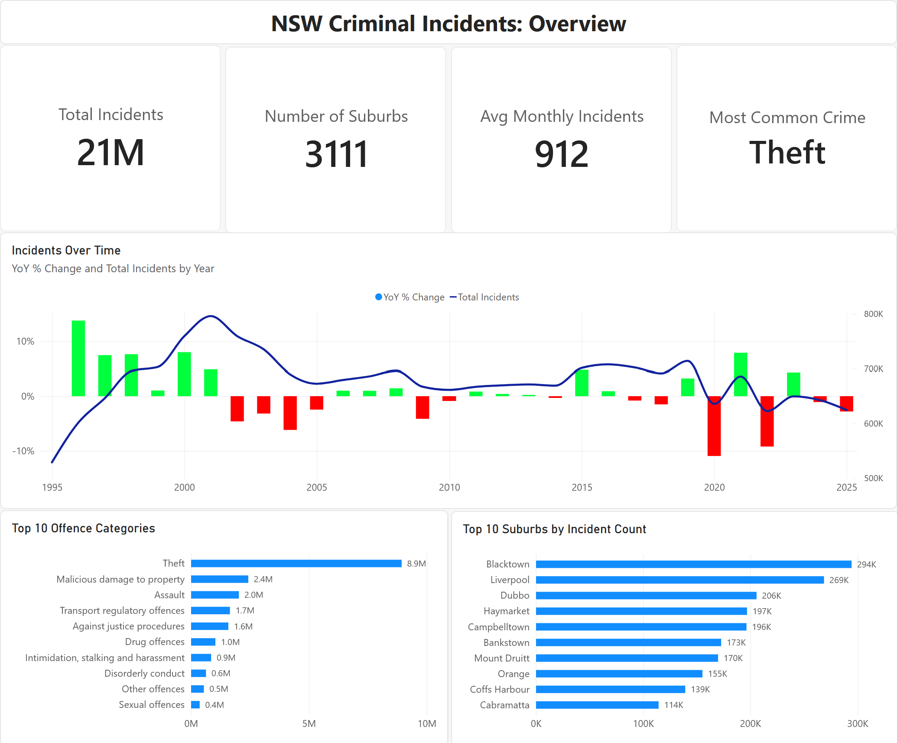

# NSW Crime Analysis (1995–2026)

**How has crime in NSW changed, and where is it concentrated?**

An end-to-end data analysis project using 30 years of NSW Police recorded crime
data, joined to 2021 ABS census data for 4,520 suburbs. Built with Python,
PostgreSQL and Power BI.

**Dashboard:** *in progress — link and screenshots coming soon*

<!-- When the dashboard is published, add:

[View the interactive dashboard](YOUR_PUBLISH_TO_WEB_LINK)
-->

---

## Key findings

1. **Recorded crime peaked in 2001 and is now 21% lower.** NSW recorded 796,000
   incidents in 2001, compared with 626,000 in 2025.

2. **The most disadvantaged suburbs have about 4 times the crime rate of the
   least disadvantaged.** This compares the most and least disadvantaged tenths
   of suburbs, using the ABS's Index of Relative Socio-economic Disadvantage
   (IRSD). Unemployment was the strongest single factor (r = 0.31).

3. **The kinds of crime recorded have changed.** In 1995–1997, 8 of the 10 most
   common offences were theft. By 2023–2025, only 3 were, and transport offences
   and bail breaches led the list.

4. **COVID-19 changed crime in two different ways.** Recorded crime fell 13% in
   2020. In 2021, July and August spiked during the Delta lockdown, most likely
   because of public health order breaches. Without them, crime kept falling.

5. **Violent crime rates are highest in regional NSW.** 9 of the 10 suburbs with
   the highest assault and homicide rates are regional towns, such as Lismore,
   Moree and Bathurst.

Full results, tables and limitations: [docs/findings.md](docs/findings.md)

---

## How it was built

1. **Cleaned and reshaped** the BOCSAR files from wide to long format with Python
   (105.9 million suburb rows), with checks for duplicates, missing values and
   row counts.
2. **Loaded into PostgreSQL** through staging tables, into a normalised schema
   with foreign keys.
3. **Validated coverage** against the NSW total. This check found that the
   original suburb file stopped at "Padstow". After reloading, suburb data covers
   99.6% of NSW incidents.
4. **Matched suburb names to ABS census areas** using regex cleaning. All 4,520
   suburbs matched.
5. **Added census and SEIFA data,** and built a yearly summary table for faster
   analysis.
6. **Analysed in SQL:** trends, rankings, per-capita rates, correlations, and
   comparisons by disadvantage decile, tested at several population floors.
7. **Built a Power BI dashboard** around the main question *(in progress)*.

Problems I hit along the way, and how I fixed them:
[docs/challenges_and_fixes.md](docs/challenges_and_fixes.md)

---

## Tools

| Tool | Used for |
|---|---|
| **Python (pandas)** | Cleaning and reshaping the source files |
| **PostgreSQL** | Database design, loading, validation and analysis |
| **Excel** | Combining census tables into one file |
| **Power BI** | Dashboard *(in progress)* |

---

## Data sources

| Dataset | Source | Coverage |
|---|---|---|
| Recorded criminal incidents, NSW and by suburb | [NSW Bureau of Crime Statistics and Research (BOCSAR)](https://bocsar.nsw.gov.au/statistics-dashboards/open-datasets/criminal-offences-data.html) | January 1995 – June 2026 (suburb file updated 16 September 2026) |
| 2021 Census, suburbs and localities (SAL) | [Australian Bureau of Statistics (ABS) DataPacks](https://www.abs.gov.au/census/find-census-data/datapacks?release=2021&product=GCP&geography=SAL&header=S) | 2021 |
| SEIFA 2021 (IRSD and IEO) | [ABS SEIFA](https://www.abs.gov.au/statistics/people/people-and-communities/socio-economic-indexes-areas-seifa-australia/latest-release) | 2021 |

**Notes**
- **The census file was assembled by hand** in Excel from several ABS DataPack
  tables, so that step isn't scripted.
- **Large files aren't in this repository.** The cleaned suburb file is 6.5 GB.
  It can be recreated from the BOCSAR download with the Python script.

**Attribution:** crime data © State of New South Wales (NSW Bureau of Crime
Statistics and Research). Census and SEIFA data © Australian Bureau of
Statistics. Both are used under the Creative Commons Attribution 4.0 licence
(CC BY 4.0).

---

## Limitations

- **Recorded crime only:** the data reflects what police recorded, which depends
  on reporting and policing levels.
- **One census year:** per-capita and socioeconomic results use 2021 only.
- **Correlation, not causation:** the analysis shows which suburb
  characteristics move with crime rates, not what causes crime.

More detail: [docs/findings.md](docs/findings.md#limitations)
